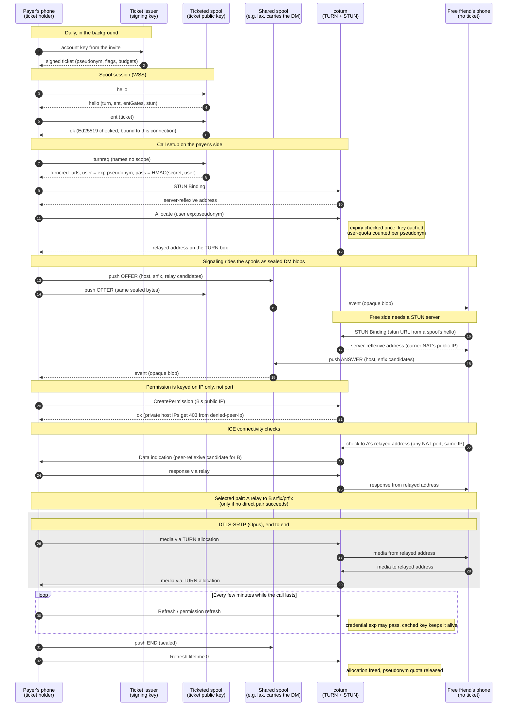

# Ticketed call sequence

How a ticket holder calls a friend who has no ticket, as far as STUN, TURN and the spool are
concerned, from ADR 2026-10.bxsg. Both parts the first draft of this page marked as missing now
exist:

- **The daily ticket and the `ent` record** (steps 1–2 and 5–6) are built on `exp/turn`. On a
  spool with `SPOOL_TICKET_KEY` and `turn` in `SPOOL_TICKET_GATES`, `turnreq` needs a live ticket,
  and the TURN username ends in a hash of the ticket's pseudonym. On a spool with no key, any
  subscribed connection gets a credential with a random suffix.
- **A STUN server for the free phone** (steps 16–17). The spool lists `SPOOL_STUN_URLS` in every
  `hello`, and knit-next's `feat/voip-calling` gathers from it on every call (C-7.6-20). Without
  it, a phone with no TURN-advertising spool offers only private host addresses. The payer's
  relay cannot permit those (`denied-peer-ip` answers 403), and coturn silently drops the free
  phone's checks. This, not the TURN protocol, is what decides the "one payer is enough" claim.

When neither phone has a radio path to the other and the live call cannot connect, the call
can fall back to a walkie-talkie whose chunks ride `cast` records (ADR 2026-10.3wdy). The
payer's cast ticket unlocks that on any spool where both phones subscribe the DM scope, in
both directions, and no TURN allocation is involved. The diagram leaves it out.

Attachments follow a different rule (ADR 2026-10.h6pt). With `files` in `SPOOL_TICKET_GATES`, an
`aput` needs the uploader's own ticket, so the free friend receives the payer's attachments but
cannot send any through that spool. One payer is enough for a call or a walkie, not for files.

What the diagram relies on, read in coturn 4.18.0 (tag `4.18.0`, commit `23c6c1d`):

- **Permissions are keyed on the peer's IP, not its port** (`src/server/ns_turn_allocation.c`,
  `addr_hash_no_port`). Any port the free phone's NAT maps to on its public IP gets through.
- **`user-quota` counts the part of the username after the colon** (`get_real_username` in
  `src/apps/relay/userdb.c`), so `<exp>:<pseudonym>` caps a pseudonym's concurrent allocations.
- **A REST credential's expiry is checked only at a session's first authentication.** The key is
  then cached (`check_stun_auth`, `hmackey_set`), so refreshes keep an allocation alive after
  `exp`.

## What the diagram leaves out

- **The free side still needs outbound UDP.** On Wi-Fi that blocks UDP, it cannot reach the relay,
  and one paid side does not help.
- **The payer may ask a second spool for TURN.** The client asks at most two spools of the DM
  scope (`MAX_TURN_SPOOLS`). Each yields its own allocations, against that TURN server's quota.
- **Several allocations per call.** libwebrtc gathers on every network and every TURN URL. Inferred
  from libwebrtc's defaults: with continual gathering and no port pruning, one call can take
  several allocations per phone, not the one drawn here.
